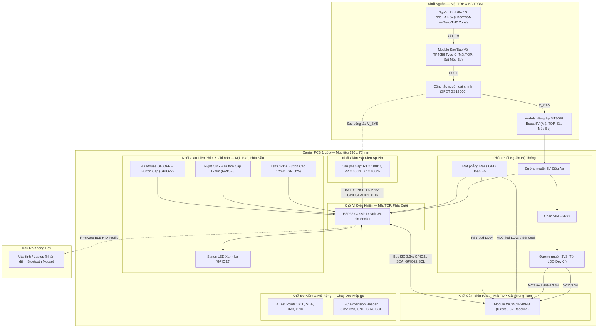

# AIR MOUSE (ESP32 CLASSIC + WCMCU-20948) — KIẾN TRÚC PHẦN CỨNG CARRIER PCB 1 LỚP

> **Tài liệu Thiết kế Kỹ thuật (Hardware Architecture Specification)**  
> **Dự án**: Chuột không gian không dây (Air Mouse BLE HID)  
> **Môn học**: Hệ thống nhúng (Embedded Systems)  
> **Phiên bản**: 4.0.0 — Direct 3.3V Hardware Bring-up Verified Baseline  
> **Trạng thái**: `BENCH_VERIFIED_ON_OWNED_MODULE` / `DIRECT_3V3_FUNCTIONAL_CONFIRMED`  
> **WCMCU Mechanical Blocker**: `RESOLVED`  
> **Chốt chặn KiCad & BLE (Remaining Gates)**: `KICAD_SYNC_STATUS: STALE / BLOCKED_PENDING_KICAD_MCP_UPDATE`; `BLE_CONNECTION_STATUS: NOT_TESTED`  
> **Hệ thống phân loại trạng thái kỹ thuật (Fact vs Assumption)**:
> - `DECIDED`: Quyết định kiến trúc đã được thống nhất và chốt cho dự án.
> - `BENCH_VERIFIED_ON_OWNED_MODULE`: Kết quả thực nghiệm đã xác minh chức năng trên đúng module phần cứng sở hữu.
> - `WEB_VERIFIED_DESIGN_REFERENCE`: Kích thước cơ khí ($26.7 \times 15.3\,\text{mm}$, pin pitch $2.54\,\text{mm}$) và đặc tính điện tham chiếu.
> - `PROVISIONAL`: Phương án thiết kế đang ưu tiên nhưng còn phụ thuộc vào dữ kiện phần cứng đo đạc thực tế.

---

## 1. Quyết định Kiến trúc & Lý do Thay đổi

### 1.1 Vai trò các nền tảng phần cứng [`DECIDED`]
- **Bo drone cũ (ICM-20602)**: Chỉ là **nền tảng thử nghiệm ban đầu (prototype / reference baseline)** và tài liệu lịch sử, **KHÔNG PHẢI** phần cứng cuối của đồ án. Tài liệu baseline cũ đã được chuyển vào `_to_delete/` trong đợt dọn dẹp 2026-10-01.
- **ESP32-S3**: Từng được xem xét ở bước trung gian nhưng **KHÔNG CÒN LÀ KIẾN TRÚC CHÍNH**.
- **Kiến trúc chính thức V1**: Tự thiết kế một **Carrier PCB 1 lớp** kích thước mục tiêu khoảng **$130\,\text{mm} \times 70\,\text{mm}$**, kết hợp các module thương phẩm cắm trên header:
  - **MCU Platform**: Bo mạch phát triển **ESP32 Classic DevKit 38-pin** phổ thông (module cắm qua female headers, không dùng chip ESP32 trần).
  - **Cảm biến IMU**: Module **WCMCU-20948** (tích hợp chip ICM-20948) chạy trực tiếp ở **miền điện áp $3.3\,\text{V}$**, giao tiếp **I2C Fast-Mode $\le 400\,\text{kHz}$** (`BENCH_VERIFIED_ON_OWNED_MODULE`).
  - **Khối chuyển mức & LDO phụ**: **LOẠI BỎ HOÀN TOÀN**. Không dùng module BSS138 và không dùng LDO AMS1117-1.8V phụ nhằm tối giản mạch in 1 lớp và loại trừ các mối tiếp xúc chập chờn.
  - **Nguồn cấp hệ thống**: Pin **LiPo 1S dẹt** bố trí ở **mặt dưới (BOTTOM SIDE)** của Carrier PCB kèm lớp cách điện/đệm cơ khí 3 tầng. Sạc qua TP4056 Type-C, nâng áp lên $5\,\text{V}$ qua MT3608 cấp vào chân `VIN/5V` của ESP32.
  - **Giao diện điều khiển**: 3 nút nhấn xúc giác trang bị **Button Cap tròn $12\,\text{mm}$**, 1 LED báo trạng thái độc lập (`GPIO32`), công tắc nguồn chính.
  - **Đo kiểm & mở rộng**: Cổng I2C expansion header $3.3\,\text{V}$ và hàng Test Points cốt lõi dọc mép bo.

### 1.2 Vì sao chọn ESP32 Classic DevKit 38-pin [`DECIDED`]
- **Khả dụng và phổ biến**: Bo ESP32 Classic 38-pin cực kỳ thông dụng, giá thành rẻ, dễ mua thay thế ngay tại các cửa hàng linh kiện Việt Nam.
- **Tích hợp phần cứng Bluetooth LE**: Cung cấp Link Layer controller BLE phần cứng; HID over GATT do firmware trực tiếp triển khai để PC/Laptop nhận diện như chuột Bluetooth chuẩn không cần cài driver riêng.
- **Dạng module cắm an toàn**: Sử dụng module DevKit cắm header giúp loại bỏ hoàn toàn rủi ro hỏng chip khi hàn nhiệt thủ công, bảo vệ mạch nạp USB-UART onboard.

### 1.3 Module cảm biến WCMCU-20948 & Quyết định Kết nối Trực tiếp 3.3V [`BENCH_VERIFIED_ON_OWNED_MODULE`]
- **Thông số cơ khí đã khóa (Locked Mechanical Reference)**:
  - **Board outline**: $26.7\,\text{mm} \times 15.3\,\text{mm}$
  - **Header**: $1 \times 10$ chân cắm thẳng hàng, bước chân `PIN_PITCH = 2.54 mm`.
  - **Footprint reference**: `PinSocket_1x10_P2.54mm_Vertical` + custom board outline $26.7 \times 15.3\,\text{mm}$.
- **Thông số điện và kết quả thực nghiệm Bring-up (Hardware Bring-up Verification)**:
  - **Kết nối thực tế**: Module WCMCU-20948 nối trực tiếp vào ESP32 ở điện áp $3.3\,\text{V}$ (`VCC -> 3V3`, `GND -> GND`, `SCL -> GPIO22`, `SDA -> GPIO21`, `NCS -> 3V3`, `AD0 -> GND`, `FSY -> GND`).
  - **Trở kéo bus I2C**: Hai điện trở dán mã "103" ($10\,\text{k}\Omega$) tích hợp sẵn trên module WCMCU-20948 đóng vai trò trở kéo nội bộ cho SDA/SCL lên $3.3\,\text{V}$.
  - **Tốc độ I2C**: Vận hành thành công ở $400\,\text{kHz}$ (Fast-Mode).
  - **Kiểm chứng thực tế (`docs/HARDWARE_BRINGUP_DIRECT_3V3_2026-09-25.md`)**:
    - Quét I2C phản hồi ACK tại địa chỉ `0x68`.
    - Chuyển bank 0 thành công, đọc thanh ghi định danh `WHO_AM_I` (`0x00`) trả về chính xác `0xEA`.
    - 100/100 lần đọc WHO_AM_I thành công trong phép thử ngắn hạn ở cả 100 kHz và 400 kHz (0 NACK / 0 lỗi bus).
    - Đọc dữ liệu burst 12 byte con quay và gia tốc kế thành công, trục Z ghi nhận trọng lực Trái Đất $\approx 1g$ khi đặt tĩnh.
    - Firmware chính đọc lại thanh ghi vật lý thành công (`PWR_MGMT_1=0x01`, `GYRO_CONFIG_1=0x1B`, `ACCEL_CONFIG=0x1B`), chạy hiệu chuẩn 200 mẫu và vòng lặp 100 Hz.
- **Ranh giới kỹ thuật với Datasheet IC trần**:
  - Datasheet TDK InvenSense DS-000189 quy định dải $V_{\text{DDIO}}$ của chip IC trần là $1.71\text{--}1.95\,\text{V}$. Dự án chấp nhận kết nối trực tiếp $3.3\,\text{V}$ như một quyết định thiết kế mẫu thử nghiệm (prototype baseline) đã được kiểm chứng chức năng thực tế trên đúng linh kiện sở hữu. Nhóm không biến điều này thành khẳng định chung cho mọi breakout ICM-20948 trên thị trường.
- **Cấu hình chân WCMCU-20948 cho chế độ I2C**:
  - `VCC`: Nối trực tiếp nguồn $3.3\,\text{V}$ từ ESP32 DevKit.
  - `GND`: Nối mass hệ thống.
  - `SCLK / SCL`: Nối trực tiếp `GPIO22` của ESP32.
  - `SDI / SDA`: Nối trực tiếp `GPIO21` của ESP32.
  - `NCS`: **Nối cứng lên $3.3\,\text{V}$** để vô hiệu hóa SPI và cố định hoạt động ở chế độ I2C.
  - `SDO / AD0`: **Nối cứng xuống `GND`** để chọn địa chỉ I2C cố định là **`0x68`**.
  - `FSY`: Nối xuống `GND`.
  - `ACL`, `ADA`: Để hở (`NC`), đây là bus I2C Master phụ của IMU, **tuyệt đối không nối vào bus I2C của ESP32**.
  - `INT`: Tín hiệu ngắt chưa sử dụng ở V1 (firmware sử dụng cơ chế polling 100 Hz).

### 1.4 Loại bỏ các cảm biến phụ khỏi bo mạch chính [`DECIDED`]
- **QMC5883L**: Loại bỏ hoàn toàn (ICM-20948 đã có sẵn la bàn AK09916 bên trong).
- **Barometer (BMP280/388/390)**: Đưa ra cổng **I2C Expansion Header $3.3\,\text{V}$** để cắm ngoài nếu cần mở rộng sau này.

---

## 2. Kích Thước & Bố Trí Cơ Khí Mục Tiêu V1 (Mechanical Target)

### 2.1 Kích thước mục tiêu V1 [`PROVISIONAL MECHANICAL TARGET`]
$$\text{PCB\_TARGET\_SIZE} \approx 130\,\text{mm} \times 70\,\text{mm} \quad (\text{PCB 130x70: PROVISIONALLY FITS})$$

- **Lý do lựa chọn kích thước $130 \times 70\,\text{mm}$**:
  1. Đủ diện tích bố cục thoáng cho module ESP32 DevKit 38-pin ($55 \times 28\,\text{mm}$).
  2. Bố cục rộng rãi, thoáng mát sau khi loại bỏ module LDO 1.8V và module chuyển mức BSS138, tối ưu hóa việc đi dây 1 lớp.
  3. Tối đa hóa khoảng cách cách ly giữa module WCMCU-20948 và cuộn cảm nguồn xung MT3608 ($> 35\,\text{mm}$).
  4. Đủ không gian công thái học cho 3 nút bấm có nắp **Button Cap đường kính $12.0\,\text{mm}$** ($D_{center} \approx 15.3\,\text{mm}$, khe hở $\ge 3.3\,\text{mm}$).
  5. Đủ diện tích ở mặt dưới (BOTTOM) để dành riêng một **Battery Keepout Zone** an toàn cho cell pin LiPo 1S phẳng ($50 \times 34\,\text{mm}$) mà không bị chân linh kiện xuyên lỗ đâm thủng (`BATTERY ZERO-THT: PASS IN CURRENT PLACEMENT MODEL`).
  6. Đi dây 1 lớp thông thoáng, ước tính chỉ cần 1–2 jumper mặt TOP (`JUMPER: MINIMAL ESTIMATE`).

---

## 3. Sơ Đồ Khối Hệ Thống (System Block Diagram)



---

## 4. Bố Cục Không Gian & An Toàn Cơ Khí (Mechanical Placement & Safety)

### 4.1 Phân vùng mặt trên (TOP-SIDE Placement)
1. **Phía đầu bo mạch ($X = 0\text{--}30\,\text{mm}$)**:
   - 3 nút bấm xúc giác 12x12mm có gắn **Button Cap tròn đường kính $\varnothing 12.0\,\text{mm}$**.
   - LED báo trạng thái (`GPIO32`) đặt ở trung tâm lùi về sau, không bị ngón tay che khi bấm chuột.
2. **Khu vực cảm biến IMU ($X = 40\text{--}65\,\text{mm}$)**:
   - Module WCMCU-20948 đặt gần trung tâm cơ học (không còn linh kiện BSS138/AMS1117).
   - Khoảng cách không gian Euclidean tới cuộn cảm MT3608 đạt $> 36\,\text{mm}$, giảm thiểu nhiễu điện từ trường.
   - Cách ly rung chấn từ nút bấm $> 30\,\text{mm}$.
3. **Khu vực vi điều khiển ESP32 ($X = 72\text{--}127\,\text{mm}$)**:
   - Đặt ở mặt TOP, phía đuôi bo mạch.
   - Ăng-ten PCB quay về mép sau hoặc nhô ra ngoài mép Carrier PCB (Antenna Overhang). Vùng hở clearance $\approx 15\,\text{mm}$ không có đồng/kim loại/pin.
4. **Khu vực khối nguồn (Dải mép trên $Y = 2\text{--}19\,\text{mm}$)**:
   - Module sạc TP4056 Type-C, công tắc trượt SPDT, module MT3608 đặt dọc mép trên.
   - Cách ly nhiệt hoàn toàn khỏi vị trí đặt pin LiPo ở mặt dưới.

### 4.2 Tiêu chuẩn bảo vệ pin LiPo (BATTERY ZERO-THT IN MODEL)
- Pin LiPo 1S 1000mAh ($50 \times 34 \times 5.2\,\text{mm}$) đặt tại $X = 22\text{--}72\,\text{mm}$, $Y = 20\text{--}56\,\text{mm}$ ở mặt đáy.
- Hoàn toàn không có chân hàn xuyên lỗ sắc nhọn đâm vào pin (`BATTERY ZERO-THT: PASS IN CURRENT PLACEMENT MODEL`).
- Bắt buộc lót đủ 3 tầng cách ly: `Mặt hàn PCB -> Băng keo Kapton -> Xốp EVA/PE 1.5mm -> Túi pin LiPo`.

---

## 5. Khối Nguồn, Đo Kiểm & Đi Dây PCB 1 Lớp

### 5.1 Khối nguồn & Kiểm chứng thực tế [`DECIDED`]
- Kiến trúc nguồn: `LiPo 1S -> TP4056/protection -> switch -> boost 5V -> ESP32 5V/VIN -> ESP32 3V3 -> WCMCU VCC (Direct 3.3V)`.
- Cung cấp đường nguồn đầu vào ổn định; độ ổn định thực tế phải được kiểm chứng dưới các xung dòng phát BLE của ESP32.
- Bắt buộc đo và vi chỉnh điện áp MT3608 về đúng $5.0\,\text{V} \pm 0.1\,\text{V}$ trước khi cắm ESP32.

### 5.2 Điểm đo kiểm (Test Points - TPs) [`DECIDED`]
- 4 test point cốt lõi dọc mép ngoài bo mạch:
  `SCL`, `SDA`, `3V3`, `GND`.
- Cho phép kẹp que đo Logic Analyzer kiểm tra trực tiếp bus I2C và nguồn nuôi cảm biến.

---

## 6. Đề Xuất Bảng Gán GPIO Cho ESP32 Classic 38-Pin (Audited Candidate Map)

Chi tiết mạng và kết nối pin-to-pin xem tại [`docs/schematic/SCHEMATIC_NETLIST.md`](schematic/SCHEMATIC_NETLIST.md) (V2.0.0 — Direct 3.3V).

> [!NOTE]
> **Tất cả các chân dưới đây đều ở trạng thái `CANDIDATE`** cho tới khi đối chiếu nhãn chân (pin labels) trên bo mạch ESP32 38-pin thực tế.

| Chức năng hệ thống | Chân GPIO ưu tiên | Trạng thái | Ghi chú & Ràng buộc an toàn phần cứng |
| :--- | :---: | :---: | :--- |
| **IMU_SDA** | **GPIO21** | `CANDIDATE` | Chân phần cứng I2C0 SDA. Nối trực tiếp chân SDA của WCMCU-20948. |
| **IMU_SCL** | **GPIO22** | `CANDIDATE` | Chân phần cứng I2C0 SCL. Nối trực tiếp chân SCL của WCMCU-20948. |
| **Button 1 (Left Click)** | **GPIO25** | `CANDIDATE` | Digital Input có pull-up nội, tiếp điểm đóng về GND. |
| **Button 2 (Right Click)** | **GPIO26** | `CANDIDATE` | Digital Input có pull-up nội, tiếp điểm đóng về GND. |
| **Button 3 (Air Mouse ON/OFF)** | **GPIO27** | `CANDIDATE` | Digital Input có pull-up nội, hỗ trợ RTC GPIO Wakeup từ Deep Sleep. |
| **Status LED** | **GPIO32** | `CANDIDATE` | Chân Digital Output đa dụng, không vướng strapping pin. |
| **Battery ADC** | **GPIO34** | `CANDIDATE` | Kênh `ADC1_CH6` (Input-Only). Tránh xung đột ADC2 khi bật Wi-Fi sau này. |
| **SPI SCK** | **GPIO18** | `RESERVED` | **Dự phòng cho V2**: Không nối trên bo carrier V1. |
| **SPI MISO** | **GPIO19** | `RESERVED` | **Dự phòng cho V2**: Không nối trên bo carrier V1. |
| **SPI MOSI** | **GPIO23** | `RESERVED` | **Dự phòng cho V2**: Không nối trên bo carrier V1. |
| **SPI CS** | **GPIO33** | `RESERVED` | **Dự phòng cho V2**: Không nối trên bo carrier V1. |

### Các Chân Cần Lưu Ý & Tránh Sử Dụng:
- **GPIO5**: Là ESP32 strapping pin. Để hở (`NC`).
- **GPIO2**: Là boot strapping pin cho UART download mode. Để hở (`NC`).
- **GPIO12 (MTDI)**: `AVOID FOR THIS DESIGN`. Strapping pin chọn điện áp Flash lúc boot. Để hở (`NC`).
- **GPIO6–11**: `PROTECTED`. Nối thẳng vào chip SPI Flash nội của module ESP32. Cấm kết nối (`NC`).
- **GPIO0**: Chân chọn chế độ nạp Bootloader. Để hở (`NC`), chỉ dùng nút nhấn trên bo DevKit.

---

## 7. Định Hướng Firmware V1 (I2C Polling Pipeline Roadmap)

Việc chuyển sang giao tiếp I2C Fast-Mode $\le 400\,\text{kHz}$ giữ nguyên luồng thuật toán xử lý tín hiệu:
```text
[WCMCU-20948 Raw Data]
       ↓ (Đọc burst mẫu thanh ghi Gyroscope qua I2C 400kHz theo chu kỳ Timer/Polling)
[Unit Conversion]
       ↓ (Chuyển đổi LSB sang dps)
[Gyro Bias Calibration]
       ↓ (Lấy mẫu tĩnh bù sai lệch điểm 0 lúc khởi động)
[Low-Pass Filtering]
       ↓ (Lọc thông thấp số triệt rung tay)
[Dead-Zone Thresholding]
       ↓ (Vùng chết loại bỏ hiện tượng trôi tự do khi để yên chuột)
[Relative Rate Control Mapping]
       ↓ (Ánh xạ vận tốc góc sang độ dịch chuyển con trỏ dX, dY)
[BLE HID Report Packing]
       ↓ (Đóng gói report chuột Bluetooth 5 byte: Buttons, dX, dY, Wheel, Pan)
[PC / Laptop nhận chuyển động con trỏ]
```
- **Driver thanh ghi mỏng**: Firmware tự viết hàm đọc/ghi thanh ghi ICM-20948 qua I2C (`i2c_master_read_from_device` hoặc `Wire.h`) để phục vụ giải trình học thuật.
- **Tiến độ**: Firmware đã được lập trình hoàn tất, biên dịch thành công trên PlatformIO và nạp kiểm thử thực nghiệm thành công trên phần cứng thật (`BENCH_VERIFIED_ON_OWNED_MODULE`).
